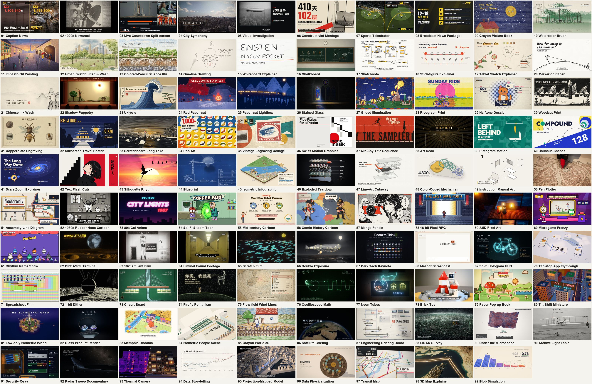
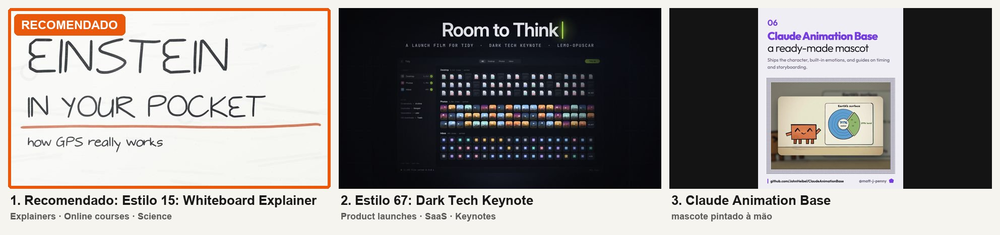

# Comece aqui (para quem não é da área técnica)

Você **não precisa saber programar**. Quem instala e usa as ferramentas é o Claude. Você só conversa com ele e escolhe o que gosta.

## O que é o Motion Turbo, em uma frase

É um "pacote de superpoderes" para o Claude fazer **vídeos animados com cara de estúdio**: 99 estilos visuais prontos, 3D, efeitos de brilho, pixel art, um mascote desenhado à mão e cortes no ritmo da música. Tudo grátis e rodando no seu computador.

*Os 99 estilos de vídeo que você pode escolher. Pôsteres do projeto Lemo-Opuscar (CC BY 4.0), créditos em [CREDITOS.md](CREDITOS.md).*

## Do que você precisa

| Item | Para quê | Custa? |
|---|---|---|
| Um computador com Windows, Mac ou Linux | onde os vídeos são feitos | já tem |
| **Claude Code** (app Claude no computador, aba "Code", ou o Claude Code no terminal) | é o Claude que instala e cria os vídeos | precisa de um plano do Claude |
| Internet | para baixar as ferramentas na primeira vez | — |
| ~2 GB livres no disco | ferramentas e bibliotecas | — |

O resto (Node, Python, ffmpeg etc.) o Claude confere e, se faltar algo, **pergunta antes de instalar**.

## Passo a passo da instalação (uns 10 a 20 minutos)

1. Abra o **Claude Code** (no app do Claude, a aba **Code**).
2. Comece uma conversa nova e **cole esta frase**:

   > Instale a skill Motion Turbo do repositório https://github.com/mxcapellani/motion-turbo-skill no meu Claude global. Siga o arquivo INSTALAR.md à risca: verifique antes, instale só o que faltar, não sobrescreva nada do que eu já tenho e me explique cada passo em linguagem simples. No final, rode a verificação e me mostre o relatório.

3. O Claude vai pedir **permissão** algumas vezes para rodar comandos (baixar arquivos, instalar). Leia a frase curta que ele mostra e clique em **Permitir**. Se algo parecer estranho, clique em **Negar** e pergunte "o que esse comando faz?".
4. Se ele disser que falta algum programa básico (como Node ou Python), ele vai explicar e pedir o seu ok. Pode aceitar: são programas gratuitos e comuns.
5. No fim, ele mostra uma tabela com **OK** (está pronto), **DICA** (algo opcional que deixa o vídeo melhor) e, se houver, **FALTA** (o que não deu para instalar e por quê).
6. **Feche essa conversa e abra uma nova.** As ferramentas novas só aparecem numa conversa nova.

## Como pedir um vídeo

Numa conversa nova, escreva algo como:

> /motion-turbo
> Quero um vídeo de 30 segundos para o Instagram explicando como funciona o GPS.

O Claude vai:
1. **Fazer até 4 perguntas rápidas:** o tema, o objetivo (explicar, vender, contar uma história), o formato (vertical para Reels/Shorts ou horizontal) e se você tem logo, cores, narração ou música.
2. **Sugerir 3 caminhos diferentes**, cada um com um estilo e o motivo. A **opção 1 é sempre a que ele recomenda** para o seu tema (marcada como RECOMENDADO). Se você não souber escolher, é só dizer "escolhe você".
3. **Mostrar uma imagem** com as 3 opções numeradas, para você escolher olhando:

   
   *Exemplo: (1) estilo quadro branco, (2) estilo apresentação de tecnologia, (3) mascote pintado à mão.*

4. Você responde só "**a 1**" (ou "a 2 mas com cores da minha marca").
5. Ele mostra o **roteiro** e **uma imagem parada** do vídeo. Você aprova ou pede ajustes.
6. Só então ele faz o vídeo inteiro e entrega o arquivo **MP4**.

### Frases prontas para copiar

- "Me mostra todos os estilos de vídeo."
- "Quero um vídeo de lançamento do meu site: www.meusite.com.br"
- "Faz um vídeo fofo com um mascote explicando por que o céu é azul."
- "Quero um vídeo estilo videogame retrô sobre a história do meu negócio."
- "Me dá ideias de vídeo para o meu perfil de receitas."
- "Coloca títulos animados e legendas no meu vídeo falando." (HyperFrames)
- "Um vídeo de lançamento sem cortes, a câmera sempre andando." (One Take, grátis só para uso não comercial)
- "Um documentário de 15 minutos sobre a história do Egito com mapas."
- "O Motion Turbo está funcionando?"

## Para o vídeo ficar ainda melhor

O Claude vai sugerir isso quando fizer sentido. Você também pode já mandar junto:

| Se você tiver... | O vídeo ganha... |
|---|---|
| **Logo** (PNG ou SVG) e **cores da marca** (ex.: #0F1C2E) | a cara da sua marca |
| **Um texto ou roteiro**, mesmo que simples | a mensagem exata que você quer |
| **Uma música** (MP3) que você pode usar | cortes no ritmo da música |
| **Sua voz gravada** (pelo celular mesmo) | narração com a sua voz; o Claude pode legendar |
| **Prints ou o link** do seu app ou site | vídeo de lançamento com as telas reais |
| **Um vídeo de referência** de que você gosta | um estilo mais parecido com o que você imagina |

Uma ferramenta **paga e opcional**: a **Collage B-roll** (colagem de papel animada por baixo da sua fala), que cobra por vídeo no Gemini. O Claude só instala se você aceitar o custo.

Opcionais que o Claude pode instalar se você quiser (todos grátis): **narração por voz sintetizada**, **trilha sonora gerada**, **legendas automáticas** e o **Blender** (para cenas 3D realistas).

## Dúvidas comuns

**Custa alguma coisa?**
As ferramentas são gratuitas e rodam no seu computador. Você só precisa do seu plano do Claude. Se algum caminho envolver serviço pago (como uma voz profissional), o Claude tem que avisar o preço e esperar o seu ok antes.

**Vai bagunçar o que eu já tenho no Claude?**
Não. A instalação confere tudo antes, só acrescenta o que falta e não apaga nem substitui nada. Se encontrar algo com o mesmo nome, ela para e avisa.

**Pedi o vídeo e ele não sabe o que é Motion Turbo.**
Abra uma **conversa nova**. Se continuar, peça: "rode a verificação do Motion Turbo".

**O vídeo está demorando muito.**
É normal: cada vídeo é desenhado quadro a quadro. Computadores sem placa de vídeo dedicada demoram mais, principalmente nos estilos de aquarela e 3D. Peça "faz uma versão mais curta primeiro" ou "escolhe um estilo mais leve".

**Apareceu uma mensagem de erro.**
Copie a mensagem, cole na conversa e diga: "deu esse erro, me explica em linguagem simples e resolve".

**Como desinstalar?**
Peça: "desinstale o Motion Turbo seguindo a seção Desinstalar do INSTALAR.md". O Claude confirma com você antes de apagar qualquer coisa.

## Glossário rápido

- **Skill:** um "manual de instruções" que ensina o Claude a fazer uma tarefa. Fica no seu computador e vale para todas as conversas.
- **Plugin:** um pacote de skills e ferramentas instalado de uma vez.
- **Repositório (repo):** uma pasta de projeto publicada no GitHub, de onde se baixam as ferramentas.
- **Renderizar:** transformar a animação em um arquivo de vídeo (MP4).
- **Terminal:** a tela de comandos que o Claude usa por trás. Você não precisa mexer nela.
