# Motion Turbo

> **Novo por aqui e não é da área técnica?** Comece pelo [COMECE-AQUI.md](COMECE-AQUI.md).

**13 ferramentas open source e receitas que deixam o motion feito pelo Claude com cara de estúdio.**

São estilos de filme prontos, 3D de verdade, física, brilho e glitch, pixel art, um mascote pintado à mão, cortes no ritmo da música e receitas de vídeo de lançamento. Tudo grátis, rodando no seu computador, disponível em qualquer sessão do Claude Code.

## Como usar

Abra qualquer sessão e diga:

> **"/motion-turbo"** ou **"quero um vídeo sobre <tema>, me sugere um estilo"**

O Claude então:
1. **Pergunta o tema**, o objetivo (explicar, vender, contar história), o formato (vertical ou horizontal) e a duração.
2. **Sugere 3 caminhos** diferentes, cada um com o estilo e o motivo. A opção 1 é sempre **a recomendada para o seu tema** (etiqueta RECOMENDADO).
3. **Mostra uma imagem** com as 3 opções numeradas, para você escolher olhando.
4. Com a sua escolha, **chama a ferramenta certa**, mostra roteiro e um quadro parado e só depois renderiza.

Outros pedidos úteis:
- "mostra todos os estilos" → catálogo com os 99 estilos (abaixo)
- "me dá ideias de prompt de vídeo de lançamento" → busca nos ~750 prompts
- "o motion turbo está funcionando?" → verificação completa

## As ferramentas

### 01 · Lemo Opuscar: 99 estilos de filme prontos
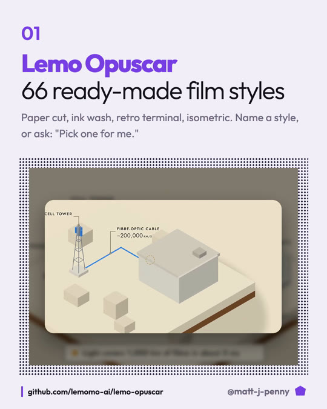
*Imagem: quadro do carrossel de Matt Penny ([@matt_penny_applied_ai](https://www.instagram.com/p/DftA9zwk4Re/)). Créditos completos em [CREDITOS.md](CREDITOS.md).*
Você escolhe um estilo (quadro branco, aquarela, ukiyo-e, isométrico, terminal retrô, noticiário...) e o Claude faz o filme inteiro em código: roteiro, desenho, trilha e mixagem.
**Peça:** "um vídeo de 30s sobre como funciona o GPS no estilo quadro branco". · [repo](https://github.com/lemomo-ai/lemo-opuscar) · [galeria animada](https://lemomo-ai.github.io/lemo-opuscar/)

### 02 · Three.js: gráficos e cenas em 3D
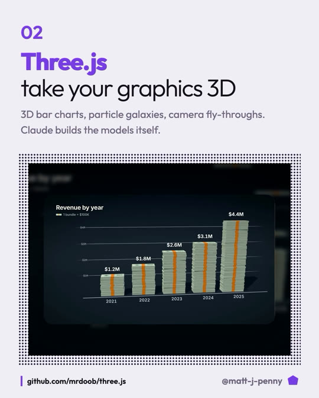
*Imagem: quadro do carrossel de Matt Penny ([@matt_penny_applied_ai](https://www.instagram.com/p/DftA9zwk4Re/)). Créditos completos em [CREDITOS.md](CREDITOS.md).*
3D no navegador: gráficos de barras em 3D, galáxias de partículas, câmera voando pela cena. O Claude monta os modelos sozinho.
**Peça:** "um gráfico 3D do faturamento por ano com câmera girando". · [repo](https://github.com/mrdoob/three.js)

### 03 · PixelFX: efeitos em pixel art
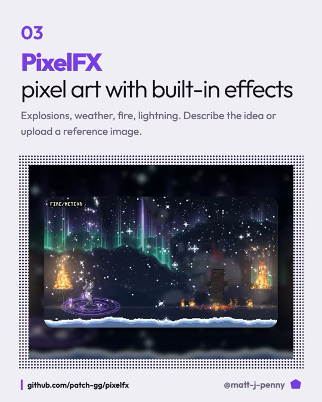
*Imagem: quadro do carrossel de Matt Penny ([@matt_penny_applied_ai](https://www.instagram.com/p/DftA9zwk4Re/)). Créditos completos em [CREDITOS.md](CREDITOS.md).*
244 efeitos prontos: explosão, fogo, raio, neve, aurora, magia. Dá para descrever um efeito novo ou mandar uma imagem de referência.
**Peça:** "uma explosão pixelada para a abertura do vídeo". · [repo](https://github.com/patch-gg/pixelfx)

### 04 · Blender MCP: o Claude controla o Blender
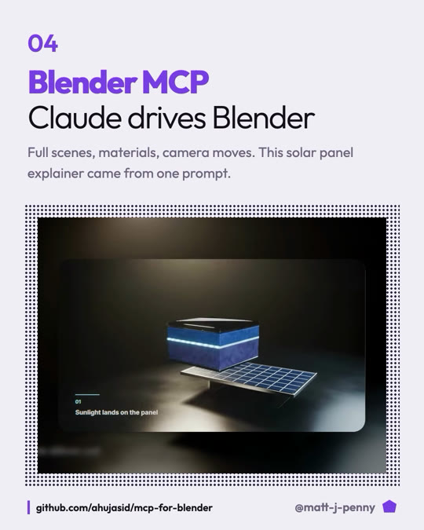
*Imagem: quadro do carrossel de Matt Penny ([@matt_penny_applied_ai](https://www.instagram.com/p/DftA9zwk4Re/)). Créditos completos em [CREDITOS.md](CREDITOS.md).*
Cenas 3D realistas no Blender, com materiais, luz e movimento de câmera, a partir de uma conversa.
**Peça:** "uma cena de produto girando num estúdio escuro". · [repo](https://github.com/ahujasid/mcp-for-blender)

### 05 · Prompt packs: ~750 prompts testados
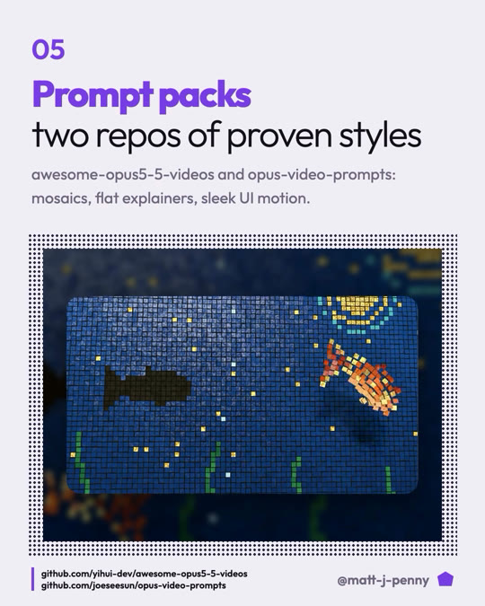
*Imagem: quadro do carrossel de Matt Penny ([@matt_penny_applied_ai](https://www.instagram.com/p/DftA9zwk4Re/)). Créditos completos em [CREDITOS.md](CREDITOS.md).*
Dois acervos de prompts de vídeos que já viralizaram (mosaicos, explainers, UI animada, 3D), para usar como ponto de partida.
**Peça:** "me mostra prompts de vídeo estilo mosaico". · [awesome-opus5-5-videos](https://github.com/yihui-dev/awesome-opus5-5-videos) · [opus-video-prompts](https://github.com/joeseesun/opus-video-prompts)

### 06 · Claude Animation Base: um mascote pronto
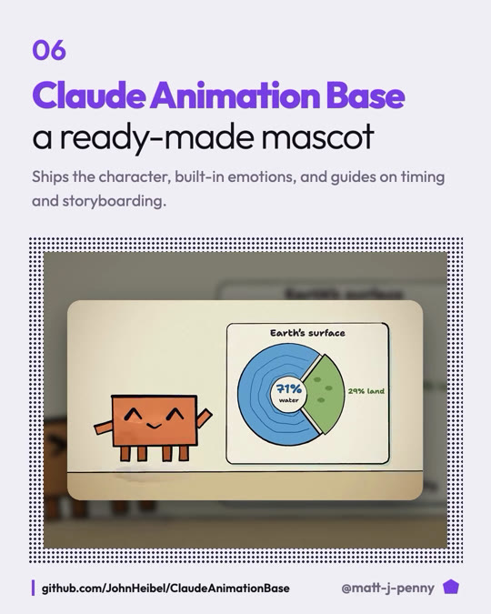
*Imagem: quadro do carrossel de Matt Penny ([@matt_penny_applied_ai](https://www.instagram.com/p/DftA9zwk4Re/)). Créditos completos em [CREDITOS.md](CREDITOS.md).*
O Clawd, um personagem pintado à mão com 31 emoções e um guia de tempo e storyboard. Ótimo para explicar com carinho e humor.
**Peça:** "um vídeo de 15s do Clawd explicando por que o céu é azul". · [repo](https://github.com/JohnHeibel/ClaudeAnimationBase)

### 07 · React Rapier: física de verdade
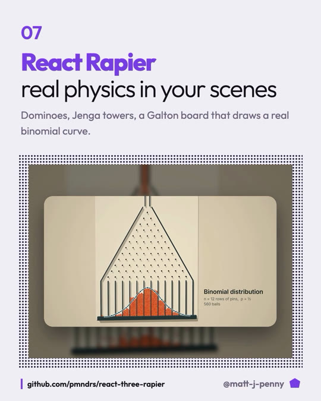
*Imagem: quadro do carrossel de Matt Penny ([@matt_penny_applied_ai](https://www.instagram.com/p/DftA9zwk4Re/)). Créditos completos em [CREDITOS.md](CREDITOS.md).*
Dominós caindo, torre de Jenga desabando, bolinhas que formam uma curva de verdade. O movimento segue a física real.
**Peça:** "uma fileira de dominós caindo que forma o logo no final". · [repo](https://github.com/pmndrs/react-three-rapier)

### 08 · React Postprocessing: brilho, desfoque, grão, glitch
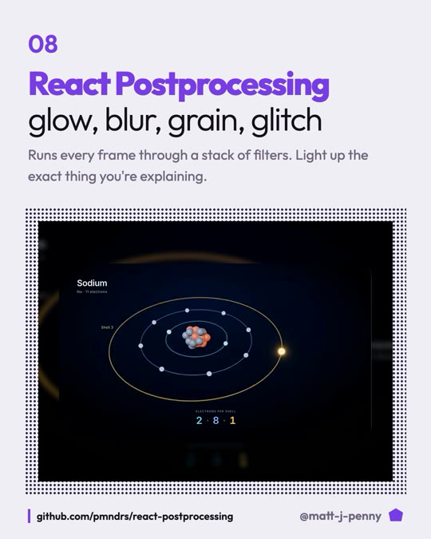
*Imagem: quadro do carrossel de Matt Penny ([@matt_penny_applied_ai](https://www.instagram.com/p/DftA9zwk4Re/)). Créditos completos em [CREDITOS.md](CREDITOS.md).*
O acabamento de cinema: faz o objeto importante "acender", põe granulado de filme, vinheta e glitch.
**Peça:** "deixa essa cena 3D com brilho neon e grão de filme". · [repo](https://github.com/pmndrs/react-postprocessing)

### 09 · librosa: tudo no ritmo da música
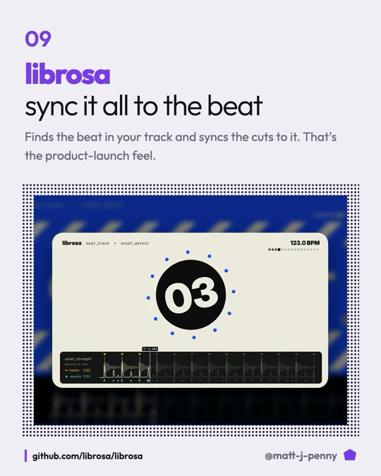
*Imagem: quadro do carrossel de Matt Penny ([@matt_penny_applied_ai](https://www.instagram.com/p/DftA9zwk4Re/)). Créditos completos em [CREDITOS.md](CREDITOS.md).*
Encontra as batidas da música e sincroniza os cortes com elas. É o que dá a "sensação de lançamento".
**Peça:** "corta as cenas na batida dessa música". · [repo](https://github.com/librosa/librosa)

### 10 · Video ShotCraft: 124 receitas de vídeo promocional
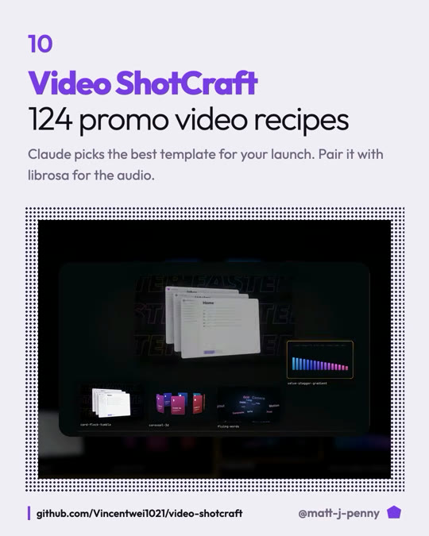
*Imagem: quadro do carrossel de Matt Penny ([@matt_penny_applied_ai](https://www.instagram.com/p/DftA9zwk4Re/)). Créditos completos em [CREDITOS.md](CREDITOS.md).*
O Claude escolhe o melhor modelo para o lançamento do seu app ou site, usa telas reais, sincroniza com a música e põe efeitos sonoros.
**Peça:** "um vídeo de lançamento de 20s do meu site". · [repo](https://github.com/Vincentwei1021/video-shotcraft)

### 11 · HyperFrames: vídeo a partir de HTML
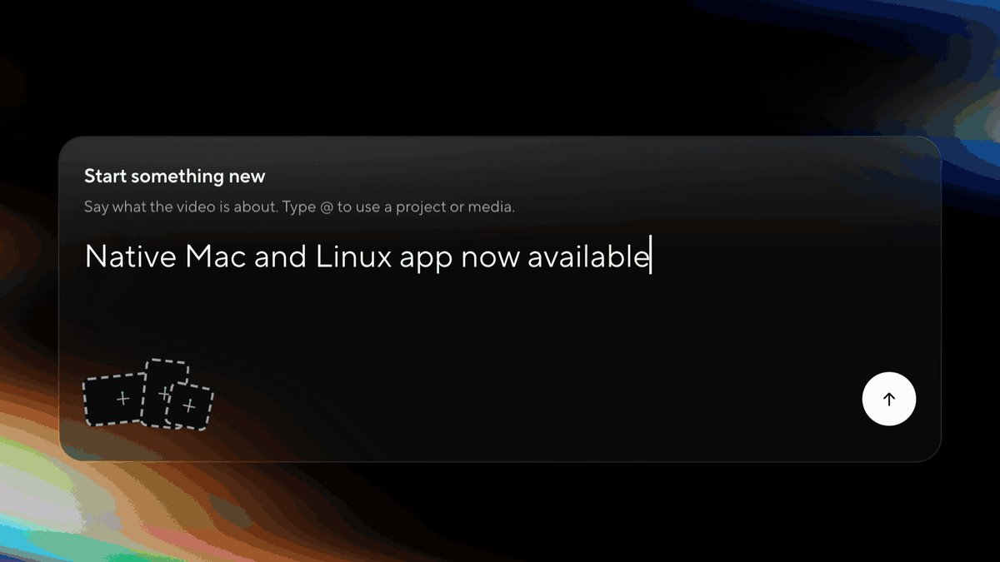
*Imagem: do repositório da HyperFrames (HeyGen, Apache 2.0). Créditos completos em [CREDITOS.md](CREDITOS.md).*
Textos animados, motion graphics, legendas e vinhetas, inclusive por cima de um vídeo seu falando. É o "editor" mais versátil do kit.
**Peça:** "coloca títulos animados e legendas no meu vídeo falando". · [repo](https://github.com/heygen-com/hyperframes)

### 12 · One Take: lançamento sem cortes
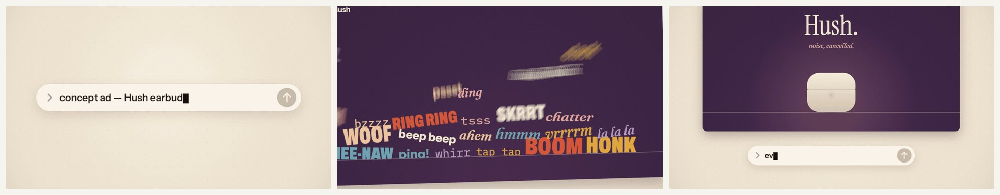
*Imagem: quadros do filme de lançamento do One Take (feitangyuan). Créditos completos em [CREDITOS.md](CREDITOS.md).*
Um filme em que a câmera nunca corta: cada cena nasce da anterior. Ótimo para lançamento de app e demonstração de recurso.
**Licença:** grátis só para **uso não comercial**. Para cliente ou empresa, existe a licença Pro (US$ 79, pagamento único).
**Peça:** "um vídeo de 20s sem cortes mostrando o meu app". · [repo](https://github.com/feitangyuan/onetake)

### 13 · Collage B-roll: colagem de papel por baixo da fala (opcional, pago)
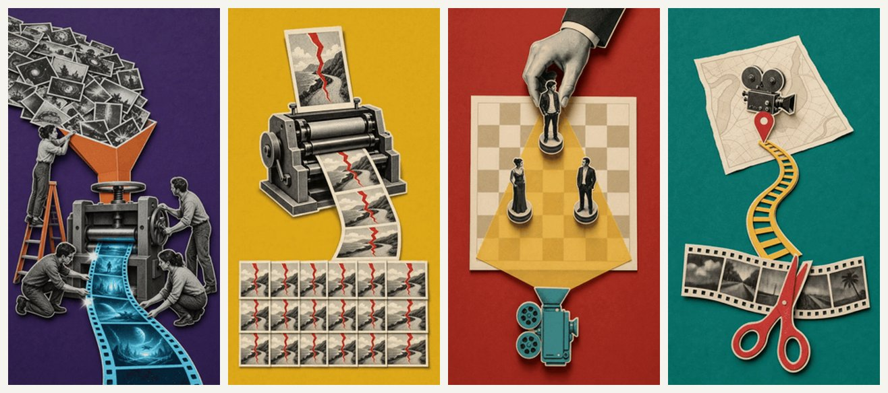
*Imagem: demos do repositório gbro-collage-broll (pyang5166, MIT). Créditos completos em [CREDITOS.md](CREDITOS.md).*
Você passa uma frase do roteiro e ela vira uma colagem animada de papel e foto, para pôr por baixo da sua fala.
**Custo:** usa a API do Gemini, cobrada por vídeo. O Claude avisa o custo e só instala com o seu ok.
**Peça:** "transforma essa frase numa colagem animada de 5s". · [repo](https://github.com/pyang5166/gbro-collage-broll)

### 14 · Receita: documentário longo com mapas
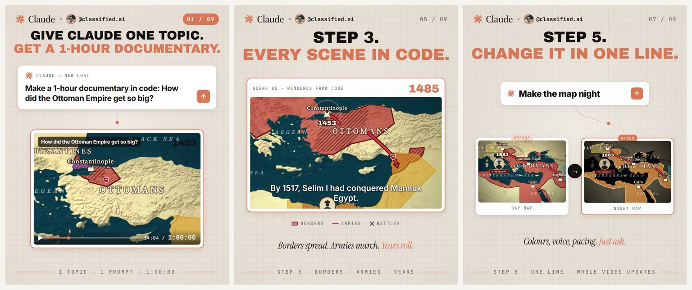
*Imagem: slides do carrossel de Nitin Chougale ([@classified.ai](https://www.instagram.com/p/DfbleGMiSJm/)). Créditos completos em [CREDITOS.md](CREDITOS.md).*
Um tema vira um documentário de 10 a 60 minutos: pesquisa, roteiro por capítulos, mapas animados em código, narração com a sua voz ou voz local e render por capítulo.
**Peça:** "um documentário de 20 minutos sobre como o Império Otomano cresceu".

## Os 99 estilos do Lemo Opuscar

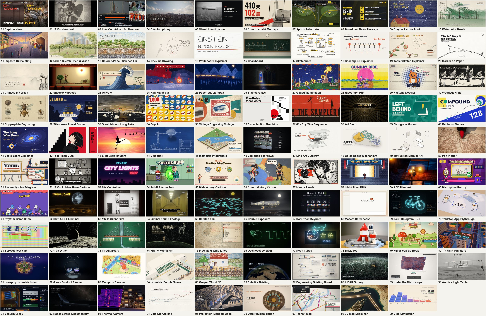
*Pôsteres: Lemo-Opuscar © 2026 Lemomo (LemoLab), CC BY 4.0. Alguns contêm material de terceiros com licença própria (lista em [CREDITOS.md](CREDITOS.md)).*

O pôster de cada estilo está em `imagens/estilos/<nome>.jpg`, e a lista completa (categoria, usos e filme de exemplo) está em `estilos.json`.

## Como as peças se encaixam

1. **Estilo e ideia:** Lemo Opuscar, prompt packs, PixelFX, Clawd.
2. **Cena 3D e efeitos:** Three.js, Blender MCP, React Rapier, React Postprocessing.
3. **Ritmo e entrega:** librosa, Video ShotCraft, HyperFrames e One Take, até o MP4 final.
4. **Extras:** Collage B-roll (pago) e a receita de documentário longo.

## Instalação

**Não é técnico? Leia primeiro o [COMECE-AQUI.md](COMECE-AQUI.md).** Ele explica tudo passo a passo, em linguagem simples.

Resumo: abra o **Claude Code** e cole:

> Instale a skill Motion Turbo do repositório https://github.com/mxcapellani/motion-turbo-skill no meu Claude global. Siga o arquivo INSTALAR.md à risca: verifique antes, instale só o que faltar, não sobrescreva nada do que eu já tenho e me explique cada passo em linguagem simples. No final, rode a verificação e me mostre o relatório.

O protocolo ([INSTALAR.md](INSTALAR.md)) verifica primeiro, instala só o que falta, faz backup antes de mexer em configuração e termina com um relatório e sugestões opcionais (narração, trilha, legendas). Para checar a qualquer momento:

```bash
python ~/.claude/skills/motion-turbo/motion_turbo.py verificar
```

## Créditos

Este pacote só organiza e instala ferramentas de outras pessoas. Todo o crédito vai para elas:
- **Ferramentas:** os autores de cada repositório linkado acima.
- **Imagens 11–14:** HyperFrames (HeyGen), One Take (feitangyuan), gbro-collage-broll (pyang5166) e carrossel de Nitin Chougale ([@classified.ai](https://www.instagram.com/p/DfbleGMiSJm/)). Ferramentas 11–13 apresentadas no reel de [Fabiano Carvalho](https://www.instagram.com/reel/Dff5HhgDeZM/); mais prompts em [Applied AI](https://www.its-applied-ai.com/r/styles).
- **Lista das 10 ferramentas e imagens 01–10:** carrossel de **Matt Penny** ([@matt_penny_applied_ai](https://www.instagram.com/p/DftA9zwk4Re/)).
- **Pôsteres e catálogo de estilos:** Lemo-Opuscar © 2026 Lemomo (LemoLab), CC BY 4.0.
- **Clawd** (o personagem laranja) é da Anthropic.

Detalhes e licenças em [CREDITOS.md](CREDITOS.md). O código deste pacote é MIT ([LICENSE](LICENSE)).
